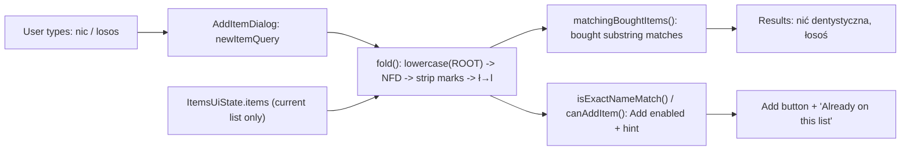

## Context

Change 10 added a live lookup to the create-item dialog: it filters the current list's bought items by trimmed, case-insensitive substring and blocks "Add" on a trimmed, case-insensitive exact match. Its design recorded Polish diacritics as an accepted limitation and a follow-up. The current helpers live in `ui/items/ItemLookup.kt` and use Kotlin's `ignoreCase`, which folds case but not accents, so typing `nic` does not find `nić dentystyczna`.

All 12 ADRs are in force; none declares `Supersedes`. Relevant ones: ADR-0004 (no experimental/new dependencies) and ADR-0011 (pure business logic in `domain`). The app is a single-module Compose app with manual DI, Room, and type-safe Navigation Compose.

C4-style component view of the changed flow:

## Goals / Non-Goals

**Goals:**
- Treat the nine Polish letters `ą ć ę ł ń ó ś ź ż` (and their uppercase forms) as equivalent to their plain ASCII base letters in lookup.
- Use the same folded comparison for result filtering and exact-name duplicate protection, symmetrically in both directions.
- Keep the fold for matching only; stored names and all other screens remain byte-for-byte unchanged.
- Preserve the Change 10 dialog behavior, layout, focus handling, and other dialogs.

**Non-Goals:**
- General transliteration of non-Latin scripts or all world languages.
- Changing the ViewModel, repository, DAO, Room schema, navigation, or adding dependencies.
- Rewriting or canonicalising existing item names, or adding a data migration.
- Fuzzy matching beyond substring + exact equality.

## Decisions

1. **One shared fold helper in `ui/items/ItemLookup.kt`.** Pipeline: trim (already done by callers) → `lowercase(Locale.ROOT)` → `Normalizer.normalize(text, Form.NFD)` → remove Unicode combining marks (`\p{M}`) → map `ł→l`. Symbols come from the JDK/Android platform, so no dependency is added (ADR-0004). Using `Locale.ROOT` keeps the result independent of the device locale (e.g. Turkish `I`). Alternatives considered: ICU `Transliterator` (rejected — `android.icu` is not available to plain JVM unit tests and device ICU versions differ); an explicit Polish-only character map (rejected — misses decomposed input pasted from elsewhere and non-Polish accents); `Collator` at primary strength (rejected — no substring primitive, and Polish collation treats `ł` as a separate letter so it would not equate `l`/`ł`); a new third-party library (rejected — ADR-0004).
2. **The `ł` case is explicit.** `Ł`/`ł` has no Unicode decomposition, so NFD + mark stripping alone still leaves it distinct. The explicit `ł→l` mapping is applied after lowercasing, so only one mapping is needed. This is the only special case in the map.
3. **Both match rules use the fold.** `matchingBoughtItems` compares folded names with folded query via `contains`; `isExactNameMatch` and `canAddItem` compare folded, trimmed strings via equality. This was an explicit decision: otherwise the user could type `nic`, see `nić` as a result, yet still create a separate `nic` item. Alternatives considered: folding only display (rejected — inconsistent identity rule); folding only duplicate protection (rejected — misses the reported use case).
4. **Matching-only, no stored change.** Names are folded in memory for comparison; the entity value and displayed label are never overwritten. No repository, DAO, schema, or migration work. Alternatives considered: canonicalising names on insert (rejected — data rewrite, loss of original spelling, out of scope).
5. **Keep the helpers in `ui/items`.** ADR-0011 was reviewed for Change 10 with the same reasoning: this is single-screen presentation logic with no second consumer. Moving the fold to `domain` would require a data-entity-to-domain mapping for no benefit. Revisit if another screen (e.g. a combined-view search) needs the same rule.
6. **Lossy equivalence is intentional.** `ź`, `ż`, and `z` all fold to `z`; this is exactly the requested `z/ź/ż` behaviour. Mark removal is generic, so combining marks in other scripts would also be ignored — accepted for this Polish-focused app and documented as a trade-off rather than adding script detection.

## Risks / Trade-offs

- **[Lossy folding collapses distinct spellings]** → Mitigation: fold only for matching; never modify stored names or labels. This preserves the original text everywhere else.
- **[`ł` is invisible to Unicode decomposition]** → Mitigation: explicit `ł→l` mapping plus a dedicated JVM test.
- **[Device-locale case folding surprises]** → Mitigation: use `Locale.ROOT`, not the default locale.
- **[Generic mark stripping affects non-Latin scripts]** → Mitigation: accepted for this app; no non-Latin item names are part of the current data set. Document in the helper's comment.
- **[Re-folding every name on each keystroke]** → Mitigation: names are short and lists are small; no caching needed. Revisit with profiling if lists grow substantially.

## Migration Plan

No data migration. Add the fold helper and extend `ItemLookupTest`; build, install the debug build on the Samsung Galaxy A52, verify plain-text queries such as `nic` and `losos`, then run the JVM and instrumented suites. Rollback by reverting this change; no stored state is altered.

## Open Questions

None. The user settled the fold scope, symmetry, duplicate protection, and matching-only behaviour during exploration; no in-force ADR needs revisiting.
