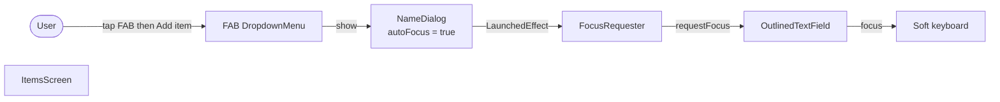

# newitem-auto-focus — Design

## Context

The items screen exposes a FAB (+) that opens a `DropdownMenu` with two actions:
"Add item" and "Import from Listonic". "Add item" sets `createDialogVisible` and
composes the shared `NameDialog` — a Material3 `AlertDialog` containing an
`OutlinedTextField` and Add/Cancel buttons. The same `NameDialog` is used by the
lists screen (new list, rename list) and by the items screen (rename item); the
import dialog is a separate composable.

Today the text field has no initial focus. After choosing "Add item" the user
must tap the field before typing, adding a tap to every item creation.

The project uses Compose BOM 2026.02.01 and Material3, with `minSdk 30` and the
Samsung Galaxy A52 as the target device. `MainActivity` sets
`android:windowSoftInputMode="adjustResize"`. Focus is local UI state: no
ViewModel, repository, Room, or navigation change is needed.

### In-force ADRs

All repository ADRs are accepted and none declares `Supersedes`, so ADR-0001
through ADR-0012 are in force. This change does not conflict with any of them:
it touches no DI wiring (ADR-0001), no module structure (ADR-0002), no
dependency versions (ADR-0004), no package root (ADR-0005), no Room schema
(ADR-0006), no navigation route (ADR-0007, ADR-0012), no ViewModel state
(ADR-0008), no item ownership (ADR-0009), no derived aggregate (ADR-0010), and
no domain logic (ADR-0011). No in-force ADR needs revisiting.

### System Context / Component Diagram



`ItemsScreen` decides that the create-item dialog is auto-focused. `NameDialog`
owns the focus mechanics and exposes only an opt-in flag, so its other call
sites keep the current behavior.

## Goals / Non-Goals

**Goals:**

- The "New item" dialog opens with its name field focused and the soft keyboard
  ready, so the user can type immediately.
- The shared `NameDialog` gains opt-in auto-focus with a safe default; the
  new-list, rename-item, and rename-list dialogs are unchanged.
- No new dependencies, no data-layer or ViewModel changes, and no Room schema
  change.
- Verify the behavior on the target device, including keyboard visibility and
  dismissal.

**Non-Goals:**

- Auto-focusing the new-list, rename, or import dialogs (possible follow-ups,
  not part of this change).
- IME action handling (e.g. pressing "Done" submitting the item).
- Redesigning the dialog or replacing it with a bottom sheet.
- Automated UI tests (deferred per ARCHITECTURE.md; manual verification on the
  target device for now).
- Accessibility or internationalization work (explicitly out of scope for the
  project).

## Decisions

### 1. Add an opt-in `autoFocus` parameter to `NameDialog`

`NameDialog` gains `autoFocus: Boolean = false`. The "New item" call site in
`ItemsScreen` passes `true`; every other call site keeps the default. The
dialog owns the focus mechanics, so callers do not need to know about
`FocusRequester` or the text field's internals.

_Alternatives considered:_

- **Always auto-focus in `NameDialog`** — simplest code, but it would pop the
  keyboard for rename and new-list dialogs too, changing behavior that was not
  requested.
- **Duplicate a `NewItemDialog` composable** — avoids touching the shared
  dialog, but duplicates the layout, validation, and saveable state handling.
- **Pass a `FocusRequester` from the caller** — gives the caller control, but
  leaks the text field's implementation detail and adds ceremony for a boolean
  decision.

### 2. Use `FocusRequester` with `LaunchedEffect`

`NameDialog` remembers a `FocusRequester`, attaches it to the
`OutlinedTextField` with `Modifier.focusRequester(...)`, and requests focus in a
`LaunchedEffect` when `autoFocus` is true:

```kotlin
val focusRequester = remember { FocusRequester() }

LaunchedEffect(autoFocus) {
    if (autoFocus) focusRequester.requestFocus()
}
```

`LaunchedEffect` runs after the composition is applied, so the text field is
attached to the requester before the request. Keying the effect on `autoFocus`
documents the dependency and avoids re-requesting focus on every keystroke.
Because the dialog is only composed while visible, the effect also runs on each
new opening.

_Alternatives considered:_

- **`SideEffect`** — runs after every recomposition, which would repeatedly
  request focus while the user types.
- **`Modifier.onGloballyPositioned`** — fires on layout changes and needs a
  guard to avoid repeated requests; fragile.
- **`LocalFocusManager.moveFocus(...)`** — depends on focus order and can focus
  the wrong element; a `FocusRequester` targets the field directly.

### 3. Rely on focus to show the keyboard; add explicit `show()` only if needed

On Android, focusing an editable text field normally requests the soft
keyboard. The primary implementation therefore only requests focus. If manual
verification on the Galaxy A52 shows that the dialog window timing prevents the
IME from appearing, the fallback is to call
`LocalSoftwareKeyboardController.current?.show()` after the focus request,
optionally after one frame.

_Alternative considered:_ always call `show()` — likely redundant and adds an
experimental/platform-dependent API surface for no benefit if focus alone
works.

### 4. Start with the simple focus request; add a frame wait only if timing requires it

The dialog is opened from a `DropdownMenu`, so the menu dismisses while the
dialog composes. `LaunchedEffect` runs after composition, but the dialog window
may not be focused yet. The initial implementation requests focus directly. If
device testing shows the request is lost during the window transition, wait one
frame (`withFrameNanos {}`) or wait for the dialog window to gain focus before
requesting. Arbitrary delays are avoided unless they prove necessary.

### 5. Scope auto-focus to the create-item dialog only

The change name and task target the new-item flow. New-list, import, and rename
dialogs are intentionally left alone: rename in particular would surprise the
user by opening the keyboard over existing text, and import is a separate
multi-line flow. The opt-in flag keeps those options open for later changes.

### 6. Verify manually on the target device; do not add UI automation

Focus and keyboard visibility depend on the dialog window and the device IME,
which is exactly the kind of behavior that is brittle to automate. ARCHITECTURE.md
defers UI tests until the UI stabilizes. Existing unit and instrumented tests
cover the data and ViewModel layers and should remain green; the focus behavior
is verified by hand on the Galaxy A52.

## Risks / Trade-offs

- [The dialog window is not focused when `LaunchedEffect` runs, so the request
  is ignored] → Start with the direct request; if it fails on the device, wait
  one frame or for the dialog window's focus before requesting.
- [The `DropdownMenu` dismissal competes with the dialog for focus] → Verify
  the real FAB → "Add item" flow, not only `NameDialog` in isolation; add a
  frame wait if the menu steals focus back.
- [The Samsung keyboard does not appear automatically inside the dialog] →
  Fallback to `LocalSoftwareKeyboardController.current?.show()` after focus.
- [The keyboard covers the Add button] → The activity uses `adjustResize`;
  verify on the A52. If the button is obscured, add `Modifier.imePadding()` to
  the dialog content or adjust the dialog properties.
- [The keyboard remains visible after the dialog closes] → Verify; if it
  lingers, hide it explicitly when dismissing.
- [The shared dialog changes behavior for rename/new-list call sites] → The
  parameter defaults to `false`; verify all four call sites during manual
  testing.
- [Rotation recreates the dialog and reopens the keyboard] → Accepted: the
  effect re-runs on recreation, matching the "ready to type" intent. A
  saveable "already focused" flag can suppress this later if it proves
  annoying.
- [No automated regression test for focus] → Manual verification on the target
  device; a Compose UI test can be added later if the dialog UI stabilizes.

## Migration Plan

No persistence or schema change, so no data migration is required. The Room
schema version stays unchanged. Deployment is a normal app build/install.
Rollback is reverting the two UI files (`NameDialog.kt` and `ItemsScreen.kt`);
no stored data or navigation state is affected.

## Open Questions

- Does the Galaxy A52 show the soft keyboard automatically after
  `requestFocus()` inside the `AlertDialog`, or is an explicit
  `keyboardController.show()` needed? Resolve during device verification.
- Should the new-list and import dialogs receive the same auto-focus treatment
  in a follow-up? Out of scope for this change.
- Should a Compose UI test assert `assertIsFocused()` as a regression guard?
  Deferred with the rest of UI automation per ARCHITECTURE.md.
- No in-force ADR is superseded or revisited by this design.
