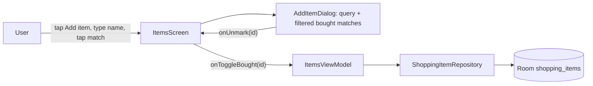

## Context

The items screen already observes every item of the current list through `ItemsViewModel.uiState` (`ItemsUiState.items`) and already exposes `toggleItemBought(id)`. Bought items are sorted to the bottom, so an item that was bought earlier can be off-screen when the user tries to add it again. The current create-item flow is the generic `NameDialog` (title, name field, Add/Cancel), with auto-focus added in Change 09. The app is a single-module Compose app using manual DI, Room, and type-safe Navigation Compose; no new dependency or data-layer change is warranted.

C4-style component view of the flow:

## Goals / Non-Goals

**Goals:**
- Show a live-filtered list of the current list's bought items while the new-item name is typed, including all bought items when the field is empty.
- Let the user un-mark a matched item directly from the dialog without closing it.
- Prevent an exact-name duplicate from being created, without blocking genuine near-matches.
- Keep the name field focused as in Change 09, and keep all actions reachable with the keyboard open.

**Non-Goals:**
- Searching across lists or the combined view.
- Automatically scrolling the main list to the un-marked item.
- Changing the rename/import/new-list dialogs, the ViewModel, repository, DAO, schema, or navigation.
- Adding quantities, case/diacritic-insensitive folding beyond `ignoreCase`, or fuzzy matching.

## Decisions

1. **Dedicated full-screen `AddItemDialog` in `ui/items`.** Alternatives considered: (a) extend the shared `NameDialog` with a results slot — smaller diff, but an `AlertDialog` leaves too little height for the list with the keyboard up and makes a generic dialog item-aware; (c) a `ModalBottomSheet` — fiddly keyboard/sheet interaction and inconsistent with the app's dialog style. A full-screen `Dialog` with `usePlatformDefaultWidth = false` gives the `LazyColumn` the remaining space and keeps Add/Cancel fixed. The shared `NameDialog` stays untouched for rename/new-list/import.
2. **Current list only, sourced from `uiState.items`.** `ItemsViewModel` already observes all items for the list, including bought ones. No new repository/DAO query; no cross-list flow. This also keeps the lookup reactive: matches recompute from the latest state on every recomposition.
3. **Two distinct match rules.** Display: bought items whose name contains the trimmed query, case-insensitively (`contains(query, ignoreCase = true)`); empty query shows every bought item. Duplicate protection: an exact trimmed, case-insensitive equality against *any* item in the current list (bought or not) disables Add. This prevents the "egg" / "eggplant" false positive that a substring-only rule would cause. A short hint (for example "Already on this list") is shown when Add is disabled, so an exact match on an already-unchecked item — which is not displayed in the results — does not silently block the action.
4. **Un-mark in place.** Tapping a result calls the existing `onToggleBought(id)` immediately and keeps the dialog open. The item leaves the results because it is no longer bought; the underlying list updates via the existing Flow. No confirm step, no separate "unmark" command.
5. **Filtering stays in the UI layer.** The filter and duplicate check are private helpers in `ui/items`, derived purely from current screen state for this one screen. ADR-0011 puts reusable pure *business* logic in `domain`, but this is single-screen presentation logic with no storage invariant or second consumer; adding a domain type would force a data-entity-to-domain mapping for no benefit. Revisit if a second screen needs the same rule.
6. **Auto-focus and keyboard.** The new dialog reuses `FocusRequester` + `LaunchedEffect` from `NameDialog`. `android:windowSoftInputMode="adjustResize"` is already configured, but device verification showed the dialog window itself still lets the IME cover the bottom action row when many results are visible. The dialog uses `DialogProperties(decorFitsSystemWindows = false, usePlatformDefaultWidth = false)` so window insets reach the content, with `systemBarsPadding()` and `imePadding()` on the surface to keep Add/Cancel above the keyboard. No explicit keyboard controller or frame wait is used.
7. **Strings follow the existing screen convention** (hardcoded in composables), keeping this change focused. This is a known deviation from ARCHITECTURE.md's resource-only rule and is left as separate cleanup.

## Risks / Trade-offs

- **[Keyboard shrinks the result list]** -> Full-screen dialog with a weighted `LazyColumn`; verify on the Samsung Galaxy A52 with the keyboard open.
- **[Exact unbought match disables Add but is not in the results]** -> Show the "Already on this list" hint whenever Add is disabled, as decided above.
- **[Polish diacritics / case folding]** -> Accepted limitation: `ignoreCase` only; document as follow-up, no scope increase.
- **[Reactive list changes while dialog is open]** -> Matches are derived from `uiState.items` each recomposition; no cached snapshot to go stale.
- **[Scope creep into other dialogs]** -> Only the "Add item" call site changes; explicit non-regression verification for rename/new-list/import.

## Migration Plan

No data migration. Build, install the debug build on the target device, verify the flows manually, then run the JVM and instrumented test suites. Rollback by reverting this change; no stored state is altered.

## Open Questions

None. The decisions above settle the questions raised during shaping; the "Already on this list" hint is a design call made here and should be checked during design review.
