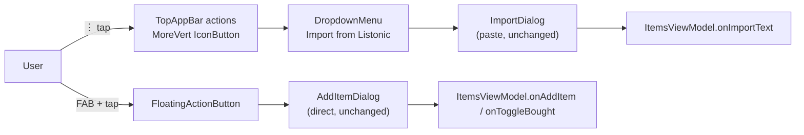

## Context

The items screen currently exposes two create/import entry points behind one FAB: `fabMenuVisible` toggles a `DropdownMenu` with "Add item" and "Import from Listonic". "Add item" opens `AddItemDialog`; "Import from Listonic" opens `ImportDialog`. The top app bar has only a Back navigation icon and the list-name title.

Import is rare compared to adding items. The extra FAB menu tap adds friction to the common case. The import parser, dialog, ViewModel action, and data path are already stable and unchanged by this move.

## Goals / Non-Goals

**Goals:**
- Make FAB a single-purpose direct action that opens `AddItemDialog`.
- Move Listonic import to a `MoreVert` overflow action in the top app bar, opening the same `ImportDialog`.
- Remove FAB menu state and keep import/add behavior otherwise unchanged.

**Non-Goals:**
- Changing `ImportDialog`, `ListonicImportParser`, `ItemsViewModel`, repository/DAO/Room, or navigation.
- Adding new import sources or changing import format/semantics.
- Redesigning the top app bar beyond adding the overflow action.

## Decisions

1. **`MoreVert` IconButton in `TopAppBar.actions`.** It is the standard Material affordance for secondary actions, compact, and leaves room for a future rare action without another layout change. Alternatives considered: labeled `Import` text button (clearer but costs title width on long list names), burger/menu icon (reads as navigation drawer), dedicated import icon (semantic ambiguity). The user chose `MoreVert` during exploration.
2. **Direct FAB opens `AddItemDialog`.** `FloatingActionButton.onClick` sets `newItemQuery = ""`, `lastAddedName = null`, `createDialogVisible = true` — the same state reset currently done by the "Add item" menu item. `fabMenuVisible` and the FAB `DropdownMenu` are removed. Alternative considered: keep menu with a single item — pointless indirection.
3. **Overflow menu state is local to `ItemsScreen`.** A small `overflowMenuVisible` `rememberSaveable`/`remember` boolean (non-persistent is fine; menu dismissal on recomposition is acceptable) drives the `DropdownMenu` anchored to the actions `Box`. This mirrors the previous FAB menu pattern at a smaller scope.
4. **Specs split by capability ownership.** `items-screen` delta fixes the stale "taps the FAB and chooses \"Add item\"" scenario and keeps the add-via-FAB requirement accurate. `items-import` delta replaces the FAB-menu entry-point requirement with the top-bar overflow requirement while preserving all import dialog/parse/ViewModel behavior requirements unchanged.

## Risks / Trade-offs

- **[Import less discoverable]** -> Acceptable; import is intentionally rare. The `MoreVert` affordance is standard and the menu label remains explicit.
- **[Long list name crowds title near action]** -> `MoreVert` is a single icon button; TopAppBar already handles title truncation/spacing. Verify visually on device.
- **[Test selectors assuming FAB menu]** -> Update any UI test that taps "Add item" from the FAB menu; `AddItemDialogMultiAddUiTest` already opens via FAB then "Add item" menu? Check: it currently does `onNodeWithText("+").performClick(); onNodeWithText("Add item").performClick()` — this will need updating as part of implementation.

## Migration Plan

No data or schema migration. Rollback is a code revert.

## Open Questions

None.