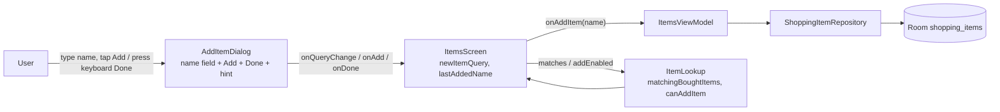

## Context

The items screen already owns the create-item session: `ItemsScreen` holds `newItemQuery` and `createDialogVisible` (`rememberSaveable`), derives `matches` and `addEnabled` from `uiState.items` through `matchingBoughtItems`/`canAddItem`, and renders the full-screen `AddItemDialog` added by Change 10. Adding currently calls `onAddItem(query)`, clears the query, and closes the dialog; the footer holds "Cancel" and "Add"; the name field is auto-focused and the keyboard stays open.

The app is a single-module Compose app on manual DI, Room, and type-safe Navigation Compose (ADR-0001, ADR-0002, ADR-0006, ADR-0007). Set to 2026-11-23.

C4-inspired component view of the add session after this change (Mermaid, lightweight):

## Goals / Non-Goals

**Goals:**
- Make the dialog a multi-add session: Add persists, clears the field, confirms, and leaves the dialog open.
- Give the dialog an honest exit: "Done" replaces "Cancel"; the footer no longer presents add-or-cancel as a choice.
- Put "Add" next to the name field, where the typed name is.
- Let the keyboard Done key perform the same add, keeping focus and the keyboard so a run of items needs no button taps.
- Keep the existing lookup, duplicate protection, and un-mark behaviour untouched.

**Non-Goals:**
- Timed/auto-dismissing confirmations, snackbars, or a session log of added items.
- Any change to `NameDialog` or the rename, new-list, delete, and import dialogs.
- ViewModel, repository, DAO, Room schema, navigation, or dependency changes.
- Localisation/resource extraction of the new strings (existing screen convention is hardcoded strings; tracked separately in ARCHITECTURE.md deviations).

## Decisions

1. **Reshape `AddItemDialog`; do not replace it.** The dialog already owns the lookup list and the focus/IME setup from Changes 09–11. Add moves into a `Row` above the results: `OutlinedTextField(Modifier.weight(1f))` plus a filled `Button("Add")` with `Modifier.height(56.dp)` to match the field and 8 dp spacing; the hint sits under that row. The footer becomes a single end-aligned `TextButton("Done")`. Alternative considered: command row plus a FAB-styled add — rejected because the results list already owns that space and a second floating control competes with the screen FAB.
2. **`lastAddedName` is state of the screen, not the dialog.** `onAddItem` is called by `ItemsScreen`, which also clears `newItemQuery`; the confirmation therefore has to be set where the add happens. `lastAddedName: String?` sits next to `newItemQuery` (both `rememberSaveable`), is set to the trimmed name on add, is cleared when the user edits the field, and is reset when the FAB opens a fresh session. The dialog stays a pure function of `query`, `matches`, `addEnabled`, `lastAddedName`, and callbacks. Alternative considered: keeping it inside the dialog and passing an `onAdded(name)` callback back — equivalent, but leaves the dialog with state it cannot own correctly (it cannot see the add succeed).
3. **One hint slot with explicit precedence.** The dialog renders at most one line under the field: if the query is non-blank and `!addEnabled`, the existing error "Already on this list"; otherwise if `lastAddedName != null`, `Added "<name>"` in `onSurfaceVariant`/`bodySmall`; otherwise nothing. Typing clears `lastAddedName` at the call site, so the two cannot co-exist and no ordering check is needed beyond that; the duplicate check still wins if state ever gets inconsistent. Alternative considered: a second, permanently reserved line — wastes vertical space above the results with the keyboard up.
4. **Add keeps focus and the keyboard.** The add handler runs `onAddItem` → clear query → set `lastAddedName`; the field never leaves composition, so focus is retained. For the keyboard path, `ImeAction.Done` makes the platform hide the IME even with focus intact, so the same handler calls `focusRequester.requestFocus()` and `LocalSoftwareKeyboardController.current?.show()` after adding. Tap-Add already ends with the keyboard visible; both paths converge. Alternative considered: `ImeAction.Next` — semantically wrong with a single field and leaves the IME in a "next field" state that does not exist.
5. **Keyboard Done is inert when Add is disabled.** The `onDone` handler checks `addEnabled` and returns without touching the query, so a duplicate or blank name gets no feedback beyond the hint that is already shown.
6. **No confirmation timer.** The line persists until the next edit, the next add, or the end of the session. A delayed clear would add lifecycle/cancellation code and timing flake to an instrumented test for no practical gain; the line is one row and disappears with the session. Alternative considered: `LaunchedEffect(delay)` auto-hide — rejected.
7. **Done discards a half-typed name silently.** Done closes and clears `newItemQuery`; nothing is created. A confirmation prompt would be noise for a personal app where re-typing a short item name is cheap. Alternative considered: disable Done while text is present — rejected, it would trap the user in the dialog.
8. **Instrumented Compose test, not JVM.** The new behaviour is dialog state (field clearing, confirmation, staying open, keyboard action) that no pure function exposes. Add `AddItemDialogMultiAddUiTest` in `ui/items` following `ItemLookupDiacriticsUiTest`'s pattern: seed a list, open the dialog via FAB → "Add item", add "Milk", type "Bread" without clearing the field manually and add it (proving the field was cleared), press Done with a third name typed (proving Done creates nothing), then assert the items screen shows exactly the two added names. Text-based finders are enough; "Add" and "Add item" are distinguishable by exact text, and "Done" is unique in the dialog.
9. **In-force ADR coherence.** Filtering and duplicate detection stay in `ui/items` presentation helpers (ADR-0011 keeps only reusable *business* logic in `domain`; these rules are single-screen and state-derived, as recorded by Change 10). No new dependency, module, DI wiring, navigation, or schema, so ADRs 0001–0012 remain untouched. The reshaped dialog is a local interaction decision, not a durable architectural one — no new ADR is warranted.

## Risks / Trade-offs

- **[IME Done re-show is device-dependent]** -> `requestFocus()` + `softwareKeyboardController.show()` in the handler; verify on the Samsung Galaxy A52. If the IME still collapses, the keyboard path degrades to "adds, keyboard closes" while tap-Add keeps the full rhythm — acceptable, and recorded for verification rather than hidden.
- **[Filled Add button narrows the name field]** (~275 dp usable on the A52 at 411 dp with 32 dp dialog padding) -> Verify visually with a long item name; the field scrolls horizontally and the list keeps full width.
- **[Confirmation mistaken for a promise that the item is in the visible list]** -> The hint names the item and the results only list bought items; the wording `Added "<name>"` (not a row in the results) plus manual verification should make the distinction clear.
- **[Rotation recreates the dialog with a stale confirmation]** -> `lastAddedName` is `rememberSaveable` and is cleared on the next edit; showing the last add after rotation is harmless.
- **[Stale confirmation on a new session]** -> Reset `lastAddedName` when the FAB opens the dialog; covered by a task.
- **[Test coupling to hint text]** -> Assert the exact user-visible string once per behaviour (`Added "Milk"`, "Already on this list"); renaming the hint is an intentional spec change anyway.

## Migration Plan

No data or schema migration. Build, install the debug build on the Samsung Galaxy A52, verify the multi-add, keyboard, hint precedence, un-mark, and Done flows by hand, then run the JVM and instrumented suites. Rollback by reverting the change; no stored state is affected.

## Open Questions

None. The in-force ADRs need no supersession. The exact visual weight of the Add button and the `Added "<name>"` wording were settled in shaping and are recorded above as decisions.
